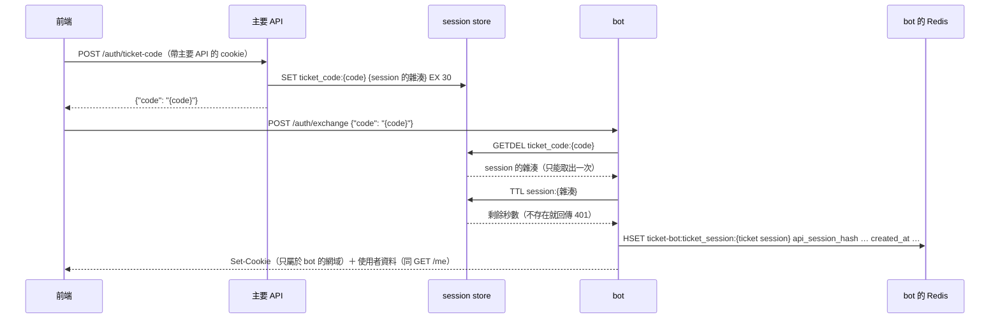
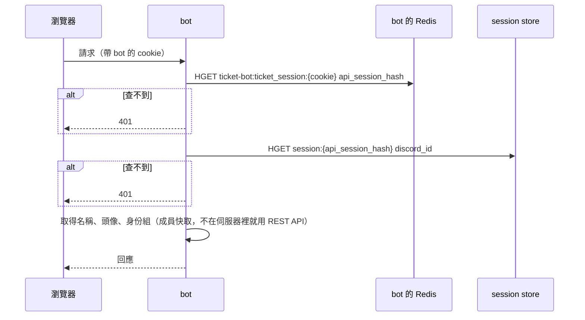

# 身分驗證

> 狀態：設計已定案。第 5 節是主要 API 與 bot 之間的約定，主要 API 依照這份文件實作。

## 1. 背景

- 網頁帳號只能用 Discord OAuth2 建立，所以每個帳號都有 Discord ID。
- 登入由**主要 API** 負責。session 是一個隨機字串，存在主要 API 網域的 cookie 裡（`HttpOnly`）；session 的資料存在 **session store**（Redis 相容，例如 KeyDB）。
- session store 採用多主架構，**在 bot 所在的地區也有一個節點**。
- bot 有**自己的子網域**，和前端、主要 API 屬於同一個 site（同一個上層網域）。

## 2. 做法：背景交換授權碼

前端在背景向主要 API 取得一次性的授權碼，交給 bot 換成 bot 自己的 session cookie：

- **每個網域的 cookie 只屬於自己**，不需要上層網域的 cookie，其他子網域都收不到。
- **瀏覽器直接連到 bot**，不經過主要 API，延遲最低，也不依賴其他服務。
- **主要 API 撤銷 session 時，bot 這邊立刻失效**，因為 bot 每次都會確認「連結的主要 API session」還存在。
- 全部在背景完成，使用者不會感覺到。

## 3. 流程

### 3.1 交換授權碼



### 3.2 之後的每個請求



- 兩次查詢都在同一個地區，只需要幾毫秒，所以**不另外快取**，登出或封鎖會**立刻**生效。
- **使用者不在 Discord 伺服器裡時**（例如被停權後從網頁開單），成員快取裡沒有他：改用 Discord REST API 取得名稱與頭像（快取幾分鐘）。他沒有任何身份組，所以只能存取自己開的客服單。
- **SSE 連線**：建立連線時驗證一次，之後每 1 分鐘重新驗證；驗證失敗就中斷連線。
- session store 或 Redis 無法連線：回傳 `503`，**不可以**因此就放行請求。

### 3.3 前端的處理

前端讀不到任何 cookie（都是 `HttpOnly`），所以不需要判斷「有沒有 cookie」，只要處理 `401`：

1. 呼叫 bot 的 API，收到 `401`。
2. 自動交換一次授權碼（3.1），再重送原本的請求。
3. 如果取得授權碼失敗（主要 API 也回傳 `401`），表示使用者沒有登入，導向登入頁面。

這段邏輯包在前端的 API 客戶端裡，每個呼叫 bot 的地方都不需要自己處理。

**SSE 要另外處理**：`EventSource` 連線失敗時，只會觸發 `error` 事件，**拿不到 HTTP 狀態碼**，無法分辨是 `401` 還是網路斷線。所以發生 `error` 時，先關閉 `EventSource`，呼叫一次 `GET /me`：

- 回傳 `401`：交換授權碼後再重新連線。
- 其他情況：等一段時間後重新連線。

### 3.4 登出

- 主要 API 刪除 session 後，bot 這邊的下一個請求就會回傳 `401`；前端重新交換授權碼也會失敗，因此導向登入頁面。
- bot 也提供 `POST /auth/logout`：刪除 ticket session，並清除 cookie。

## 4. Cookie 與 session 的規則

### 4.1 bot 的 cookie

```
Set-Cookie: __Host-ticket_session=<隨機字串>; Path=/; HttpOnly; Secure; SameSite=Lax; Max-Age=<與 ticket session 相同>
```

- **不設定 `Domain`**，cookie 只屬於 bot 的網域。
- **名稱使用 `__Host-` 前綴**：瀏覽器只接受同時符合「`Secure`、`Path=/`、沒有 `Domain`」的 `__Host-` cookie，所以**其他子網域無法設定或覆蓋這個 cookie**。這可以擋下「從其他子網域塞入攻擊者的 cookie」這一類攻擊。建議主要 API 的 session cookie 也使用 `__Host-` 前綴。
- 前端和 bot 屬於同一個 site，所以這是 same-site 請求：瀏覽器會接受跨 origin `fetch` 回傳的 `Set-Cookie`，之後也會正常送出 `SameSite=Lax` 的 cookie，不受「封鎖第三方 cookie」的影響。

### 4.2 為什麼不直接複製主要 API 的 session

bot 產生**新的**隨機字串，連結到主要 API 的 session，而不是把主要 API 的 session 直接放進 bot 的 cookie：

- bot 的 cookie 外洩時，只能用在客服單，**不能拿去呼叫主要 API**。
- 撤銷一樣會立刻生效，因為每次都會確認主要 API 的 session。
- bot 從頭到尾只拿到主要 API session 的**雜湊**，從來沒有拿到原始的 session。所以就算 bot 的 Redis 外洩，也拿不到能用來登入主要 API 的東西。

### 4.3 授權碼

- 只能使用一次（`GETDEL`），30 秒過期。
- 至少 32 bytes 的隨機資料（例如 `secrets.token_urlsafe(32)`）。
- 必須透過授權碼交換，是因為主要 API 的 cookie 是 `HttpOnly`，JS 讀不到 session 本身。這也代表就算前端遭到 XSS 攻擊，攻擊者也偷不到 session。

### 4.4 ticket session

- 存在 **bot 自己的 Redis**（與 queue 共用，`REDIS_URL`），不寫進主要 API 的 session store。
- 格式：**key 是 ticket session，value 才放主要 API 的 session**。使用 Redis hash：

  ```
  HSET ticket-bot:ticket_session:<ticket session> api_session_hash <主要 API session 的雜湊> created_at <ISO 8601 時間>
  EXPIRE ticket-bot:ticket_session:<ticket session> <秒數>
  ```

  不能把兩個值都放進 key（例如 `ticket_session:<ticket session>:<主要 API 的 session>`）：bot 收到請求時手上只有 ticket session，要用完整的 key 才能直接查詢。如果 key 裡還有主要 API 的 session，就只能用 `SCAN` 逐一比對所有 key，資料越多越慢。key 是「用來查詢的東西」，value 才是「查到的資料」。
- 用 hash 而不是單純的字串，是為了之後可以再加欄位（例如建立時的 IP）。
- **過期時間：3 天，與主要 API 的 cookie 相同**，而且**不超過主要 API session 的剩餘時間**（交換時用 `TTL` 取得；`TTL` 回傳 `-2` 表示 session 不存在，回傳 `401`；回傳 `-1` 表示沒有設定過期，就用 3 天）。使用期間不延長；過期之後，前端收到 `401` 會自動重新交換，使用者不會感覺到。
- 這是 bot 內部的資料，不屬於與主要 API 的約定，所以跟其他 bot 的 key 一樣使用 `ticket-bot:` 前綴。

### 4.5 session store 的權限

bot 使用 Redis ACL 的專用帳號，只能：

- **讀取**主要 API 的 session（`session:*`）。
- **讀取並刪除**授權碼（`ticket_code:*`）。

ACL 範例：

```
ACL SETUSER ticket-bot on >密碼 resetkeys ~session:* ~ticket_code:* resetchannels -@all +ping +hget +ttl +getdel
```

不能讀寫其他任何資料。與 session store 之間的連線要走私人網路或 TLS。多主架構的複製是非同步的，登出後可能有極短的延遲（通常是毫秒等級），可以接受。

## 5. 與主要 API 的約定

主要 API 依照這一節實作。之後任何一方要修改，都必須先通知另一方。

### 5.1 主要 API 的 session cookie

```
Set-Cookie: __Host-session=<session>; Path=/; HttpOnly; Secure; SameSite=Lax; Max-Age=259200
```

- `<session>`：32 bytes 的隨機資料，例如 `secrets.token_urlsafe(32)`。
- 有效期限 3 天（259200 秒）。

### 5.2 session store 裡的 session

```
key：   session:<sha256(session) 的 hex>
value： Redis hash
          discord_id   Discord ID（字串）
          created_at   ISO 8601，UTC
過期：  Redis TTL（EXPIRE 259200）
```

- key 用 session 的 **SHA-256 雜湊**，不存原始的 session。這樣即使 session store 外洩，也拿不到能用的 session。
- 登出：直接刪除這個 key。
- 主要 API 之後要在 hash 裡加欄位沒有問題，bot 只會讀取 `discord_id`。

### 5.3 產生授權碼

```
POST /auth/ticket-code
Cookie: __Host-session=<session>

200 OK
{ "code": "<code>" }

401 Unauthorized   ← 沒有登入或 session 已過期
```

主要 API 要做的事：

1. 驗證 session cookie。
2. 檢查 `Origin` header 在白名單內（只允許前端）。
3. 產生 32 bytes 的隨機授權碼，寫入：

   ```
   SET ticket_code:<code> <sha256(session) 的 hex> EX 30
   ```

4. 回應授權碼。CORS 要允許前端的 origin，並開啟 credentials。

### 5.4 Discord ID 的格式

Discord ID 在 JSON 與 Redis 裡一律用**字串**。snowflake 超過 JavaScript 的安全整數範圍（2^53），用數字傳的話，前端會出現精度錯誤。

## 6. CORS

前端和 bot 不在同一個 origin，所以 bot 的回應要帶 CORS header：

- `Access-Control-Allow-Origin`：只允許白名單內的 origin（`API_CORS_ORIGINS`），不能用 `*`。
- `Access-Control-Allow-Credentials: true`。少了這個，瀏覽器會丟棄 `/auth/exchange` 回傳的 `Set-Cookie`。
- 要正確回應 `OPTIONS` preflight 請求。
- 前端：`fetch` 加上 `credentials: "include"`，`EventSource` 加上 `withCredentials: true`。
- 前端的網域之後會改，所以白名單一定要用環境變數設定。

## 7. CSRF

前端與 bot 屬於同一個 site，所以 `SameSite=Lax` 擋不住來自其他子網域的偽造請求。會修改資料的請求（`POST`、`PUT`、`PATCH`、`DELETE`）要：

- 檢查 `Origin` header 是否在白名單內，不在就拒絕。
- 只接受 `Content-Type: application/json`。這會強制瀏覽器先送 preflight，讓 CORS 白名單發揮作用。

`/auth/exchange` 特別要檢查 `Origin`：否則攻擊者可以讓受害者的瀏覽器兌換**攻擊者的**授權碼，受害者就會在不知情的情況下，以攻擊者的身分使用客服單（login CSRF）。

## 8. Proxy 與用戶端 IP

- bot 只接受來自信任的 proxy（CDN、部署平台的 proxy）的請求，不要把 API 的 port 直接公開到網路上。
- 只信任來自這些 proxy 的 `X-Forwarded-For`。uvicorn 要設定 `--proxy-headers` 和 `--forwarded-allow-ips`。

## 9. SSE 經過 proxy

SSE 是長時間保持的連線，中間的每一層 proxy 都要能正常串流：

- **heartbeat**：每 25 秒送一次 SSE 註解行。很多 CDN 和 proxy 會中斷閒置超過 60～100 秒的連線。
- proxy 的 timeout 要大於 heartbeat 的間隔；`text/event-stream` 不要壓縮，也不要緩衝。
- 回應 header：`Content-Type: text/event-stream`、`Cache-Control: no-cache`。

## 10. 部署的位置

- bot、worker、資料庫、Redis、session store 的節點，都要放在**同一個地區**。bot 處理一個請求通常要查詢好幾次資料庫，跨洲的話每次都要多 100～200 ms。
- Discord 的伺服器主要在美國，bot 放在北美，連到 Discord 的延遲也比較低。

## 11. 環境變數

```
API_HOST, API_PORT
API_CORS_ORIGINS        前端的 origin（逗號分隔）
FORWARDED_ALLOW_IPS     信任的 proxy IP
SESSION_REDIS_URL       主要 API 的 session store（專用帳號，見 4.5）
AUTH_COOKIE_NAME        bot 的 session cookie 名稱（預設 __Host-ticket_session）
TICKET_SESSION_TTL      ticket session 的過期時間（預設 3 天，259200 秒）
```

`session:`、`ticket_code:` 是第 5 節與主要 API 的約定，寫死在程式裡，不做成設定。ticket session 的 key（`ticket-bot:ticket_session:`）是 bot 內部的資料。
